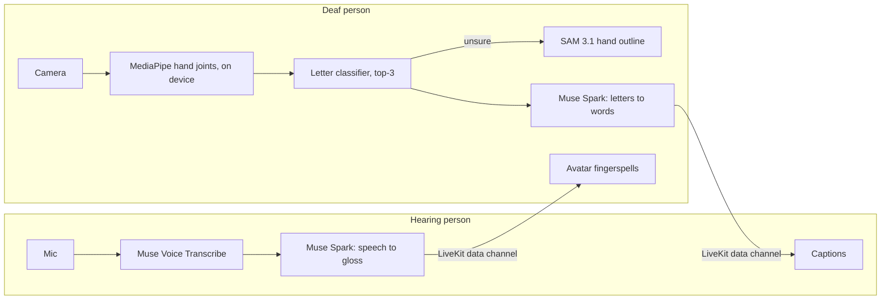

# Visign

**A two-way, live bridge between sign language and speech.** A hearing person speaks, and a deaf person sees captions plus a small avatar fingerspelling the message. The deaf person signs back, and the hearing person reads it as text. It runs in a browser on a laptop or phone, with no special hardware.

Built for the [Meta Global AI Developer Hackathon](https://cerebralvalley.ai/e/meta-ai-developer-hackathon) (Indie track). It supports **Nigerian Sign Language (NSL)** and **American Sign Language (ASL)**.

> Status: in active development. The live call (`/call`), letter classifier, 2D avatar, API and data tools are built. Next: end-to-end testing on real devices, recorded word signs, and deployment. See [PLAN.md](PLAN.md).

---

## Why

Speech-to-text helps a deaf person read what is said, but nothing translates back. When a deaf person replies in sign, the hearing person is lost. Visign works in **both directions inside one conversation**. It also lets a community teach it new signs: **record a sign once, and Visign can both understand it and perform it.**

## How it works



| Meta model | What it does in Visign |
|---|---|
| **Muse Voice Transcribe** | The hearing person's speech becomes text, one utterance at a time |
| **Muse Spark 1.3** | Shortens speech to the fewest words worth fingerspelling (gloss), and turns noisy letter guesses into words using the conversation as context |
| **SAM 3.1** | Outlines the hand to break ties between look-alike letters (M/N/S/T) and draws the on-screen hand outline |

**Design rule:** recognition runs on the device, and the server only adds intelligence. If Meta's API is slow, down or over budget, Visign keeps working with on-device results. It never stalls a conversation.

## Tech stack

| Layer | Choice |
|---|---|
| App | Next.js 16 (App Router), React 19, TypeScript, Tailwind CSS 4, installable as a PWA |
| API | Next.js Route Handlers (`app/api/*`): plain HTTP, callable from web, Android or glasses clients |
| Hand tracking | MediaPipe Tasks Vision 1.1.1, Hand Landmarker (pinned, self-hosted) |
| Calls | LiveKit (video and data channel, TURN relay included) |
| Database | Supabase Postgres (RLS on every table; an atomic budget ledger) |
| AI | Meta Model API: Muse Spark 1.3, SAM 3.1, Muse Voice Transcribe |
| Hosting | Vercel |
| CI | GitHub Actions: lint, type check, tests, build |

The reasons behind every choice (benchmarks, licenses, community size, cost) are in [ARCHITECTURE.md](ARCHITECTURE.md).

---

## Getting started

### Prerequisites
- **Node.js 24** (20.9+ works) and npm
- **Git**
- **Chrome or Edge** (camera, WebGL and the Web Speech fallback)
- Optional: **Python 3.10+**, only for `scripts/nsl_sample.py`

Works on **Windows and Linux** (and macOS).

### 1. Install
```bash
git clone https://github.com/Chiboy06/Visign.git
cd Visign
npm install
```
`npm install` also runs `postinstall`, which copies MediaPipe's runtime into `public/mediapipe/` and downloads the pinned hand model into `public/models/`, checking its SHA-256. Both folders are generated, so don't commit them. If the model download fails on a flaky connection, re-run `node scripts/copy-mediapipe.mjs`.

### 2. Environment variables
```bash
cp .env.example .env
```
Fill in `.env`. **Never commit it**; it's gitignored.

| Variable | Where to get it | Needed for |
|---|---|---|
| `MODEL_API_KEY` | [dev.meta.ai](https://dev.meta.ai/) → API keys | gloss, decode, segment, transcribe |
| `SUPABASE_URL`, `SUPABASE_SERVICE_ROLE_KEY` | Supabase → Project settings → API | the budget ledger (every paid call) |
| `LIVEKIT_URL`, `LIVEKIT_API_KEY`, `LIVEKIT_API_SECRET` | LiveKit Cloud → Project settings → Keys | video calls |

All of these are **server-only**. Never prefix them with `NEXT_PUBLIC_`.

### 3. Database
Run [`supabase/migrations/20261029000000_init.sql`](supabase/migrations/20261029000000_init.sql) once, either in the Supabase dashboard (SQL editor → paste → Run) or with the Supabase CLI (`supabase db push`).

### 4. Run
```bash
npm run dev
```
Open http://localhost:3000.

| Command | What it does |
|---|---|
| `npm run dev` | Dev server |
| `npm run build` / `npm start` | Production build / serve |
| `npm test` | Unit tests (Node's built-in test runner) |
| `npm run lint` · `npm run typecheck` | ESLint · TypeScript |
| `npm run model` | Rebuilds `public/model/letters.json` from `data/raw/asl-now` and `data/landmarks/*.json`, and prints held-out accuracy |
| `npm run latency -- scripts/fixtures/hand-crop.jpg` | Times Meta API calls from your machine (about $0.02) |

---

## Using a call

1. Open `/call`, choose **Hearing** or **Deaf**, and join. Send the other person the share link (it opens with the other role).
2. **Hearing:** hold **Hold to speak** (or Space), talk, and release. Muse Voice Transcribe turns it into text, Muse Spark shortens it to gloss, and the deaf side sees captions plus the avatar fingerspelling it.
3. **Deaf:** sign letters to your camera and hold each one for about half a second. Lower your hand to finish a word. Muse Spark decodes the letters using the conversation, and the hearing side reads the result.
4. Either side can **type** instead. This is the fallback if the mic, camera or network misbehaves.

**Letter classifier:** k-nearest-neighbours on hand-shape features that ignore position, size and which hand is used. Built from 2,122 ASLNow samples: **96.6% top-1 and 99.0% top-3 on held-out samples**. This is optimistic, because the same signers are in training and test; expect lower for new signers until NSL and team recordings are added. The weakest letters are A (vs S) and Z.

## Data tools

| Page | Purpose |
|---|---|
| `/tools/record` | Records hand landmarks (**never video**) from the webcam, with consent and an anonymous signer ID. Space captures a still letter; J, Z and word signs record 1.5 s of motion. |
| `/tools/convert` | Turns NSL images or ASLNow JSON into landmarks, with a review grid to drop mislabelled samples. Exports `landmarks.json`. |

To fetch a balanced NSL sample (it byte-ranges single images out of the 17.8 GB archive):
```bash
python -I scripts/nsl_sample.py 15        # 15 images per class into data/raw/nsl (gitignored)
```

## API

All routes accept and return JSON (except `transcribe`, which takes a WAV body). Every paid route **reserves budget first** and returns a local fallback or `{ degraded: true }` instead of failing.

| Route | Input | Output |
|---|---|---|
| `POST /api/gloss` | `{ text, context? }` | `{ gloss: ["WATER","YOU","WANT","?"] }` |
| `POST /api/decode` | `{ letters: [[{letter,p}…]…], context? }` | `{ text }` |
| `POST /api/segment` | `{ image: "data:image/jpeg;base64,…" }`, a hand crop ≤ 45 KB | `{ sam }` (raw SAM 3.1 output) |
| `POST /api/transcribe` | mono 16-bit WAV, 16 or 24 kHz, ≤ 2 MB | `{ text }` |
| `POST /api/token` | `{ room, role: "hearing" \| "deaf" }` | `{ token, url }` (LiveKit, 1 hour) |
| `GET /api/health` | — | `{ ok: true }` |

**Budget guard:** spend is recorded in `usage_ledger` by one locked Postgres function. SAM stops at **$60**, and every paid call stops at **$75** (half of the $150 hackathon credits).

## Project structure
```
app/
  api/            Route handlers (gloss, decode, segment, transcribe, token, health)
  tools/          Recorder and converter pages
lib/              Shared code: Meta client, budget, datasets, MediaPipe helpers (+ lib.test.ts)
supabase/         SQL migrations
scripts/          Latency test, NSL sampler, MediaPipe copy step, test fixtures
public/models/    MediaPipe hand model (downloaded and verified on install, not in git)
PLAN.md           What we build, day by day
ARCHITECTURE.md   How and why: stack, scaling, load, security, measurements
```

## Working together

- **Branch from `main`** with a short name: `feature/avatar-2d`, `fix/recorder-safari`. Keep branches short-lived (1–2 days) and open a pull request into `main`.
- **Commit messages:** `feat:`, `fix:`, `docs:`, `test:`, `chore:`, `refactor:`, followed by a short line saying *why*.
- **CI must pass:** lint, type check, tests and build run on every push and PR.
- **Before you push:** run `npm test && npm run lint && npm run typecheck`.
- **Never commit** `.env`, `data/raw/`, `public/mediapipe/`, `public/models/` or `.next/`. They're all gitignored, so keep it that way.
- **Line endings** are normalized to LF by `.gitattributes`, so Windows and Linux machines produce identical files.
- New external API calls go through `lib/meta.ts` and **must** call `reserve()` from `lib/budget.ts` first.

## Data and credits

| Dataset | License | Use |
|---|---|---|
| [Nigerian Sign Language (NSL) Alphanumeric Dataset](https://zenodo.org/records/21672976), Adeniyan, Afolayan & Johnson (2026) | CC BY 4.0 | NSL letters A–Y and digits 1–9 |
| [ASLNow!](https://huggingface.co/datasets/sid220/asl-now-fingerspelling), sid220 | MIT | ASL letters A–Z (MediaPipe landmarks) |
| Team recordings | Ours | J/Z motion, word signs (NSL and ASL), avatar motion |

The test photo in `scripts/fixtures/` is a public-domain NASA image (see `SOURCES.txt`). It is **not** sign language and is used only to time SAM.

## Roadmap
- Live call (LiveKit), classifier, 2D avatar, then a 3D VRM avatar
- App-store builds (Capacitor), and smart glasses via [xg-glass-sdk](https://github.com/hkust-spark/xg-glass-sdk)
- More sign languages: each language is data (recordings), not code
- Review by deaf signers of every recorded sign

## License

[MIT](LICENSE) © 2026 Chinaza. Dataset licenses above apply to their data.
